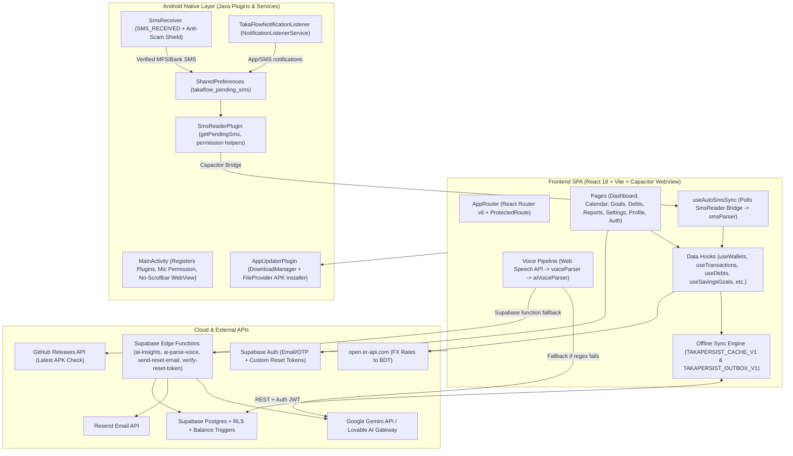

# TakaFlow Finance Tracker Vault — System & Architecture Documentation

> **Handover Edition** · **Baseline:** Post-`5dcd55e` (`v1.0.7`) WIP fixes + Handover Docs on `main` · **Last Verified:** 2026-11-10  
> **Companion Docs:** [DIFFICULTIES.md](DIFFICULTIES.md) (Known Bugs, Security & Architecture Audit) · [TARGETS.md](TARGETS.md) (Prioritized Handover Roadmap) · [README.md](README.md) (Quick Start)

This document is the single-source technical reference for everything currently built in **TakaFlow** across the Web SPA, Supabase backend, and Android Capacitor native layer.

---

## 1. Product Overview & Distribution

**TakaFlow** ("Finance Tracker Vault") is a multi-wallet personal finance web and Android application tailored to Bangladesh workflows (bKash, Nagad, Rocket, Upay, Cellfin, local banks, and cash), alongside multi-currency support (`BDT`, `USD`, `EUR`, `GBP`).

### Key Implemented Capabilities
- **Multi-Wallet Vault & Multi-Currency Net Worth**: Supports `BDT`, `USD`, `EUR`, and `GBP` wallets with live FX conversion to ৳ via `open.er-api.com`, plus a hold-to-peek **Spy Privacy Mode** with haptic vibration ([`src/pages/Dashboard.tsx`](src/pages/Dashboard.tsx#L65-L198)).
- **Offline-First Caching & Mutation Outbox**: Permanent TanStack Query persistence (`TAKAPERSIST_CACHE_V1`) plus an optimistic `localStorage` outbox queue (`TAKAPERSIST_OUTBOX_V1`) supporting background cloud sync ([`src/lib/offlineSync.ts`](src/lib/offlineSync.ts)). _(See [DIFFICULTIES.md](DIFFICULTIES.md#3-critical-offline-sync-native-bridge--state-corruption-bugs) for critical reliability bugs in the current outbox implementation.)_
- **Walkie-Talkie Bengali / Banglish / English Voice Entry**: Web Speech API (`bn-BD` / `en-US`) paired with a client-side rule/NLP parser ([`src/lib/voiceParser.ts`](src/lib/voiceParser.ts)) and a Gemini AI fallback ([`src/lib/aiVoiceParser.ts`](src/lib/aiVoiceParser.ts), [`supabase/functions/ai-parse-voice/index.ts`](supabase/functions/ai-parse-voice/index.ts)).
- **Android Auto-Tracking (SMS + Push Notifications + Anti-Scam Shield)**: Native Android `BroadcastReceiver` ([`SmsReceiver.java`](android/app/src/main/java/com/takaflow/financetracker/SmsReceiver.java)), `NotificationListenerService` ([`TakaFlowNotificationListener.java`](android/app/src/main/java/com/takaflow/financetracker/TakaFlowNotificationListener.java)), Capacitor bridge ([`SmsReaderPlugin.java`](android/app/src/main/java/com/takaflow/financetracker/SmsReaderPlugin.java)), and JS parser ([`src/lib/smsParser.ts`](src/lib/smsParser.ts)).
- **Bangladesh "Shortage Rescue" UX**: [`InsufficientBalanceModal.tsx`](src/components/InsufficientBalanceModal.tsx) intercepts overdraft expenses and guides the user to either borrow money (creating a Debt record + expense atomically in UX) or transfer funds from another wallet.
- **Full Finance Suite**: Monthly budgets, savings goals with milestone confetti, debt ledger (borrowed/lent + partial repayments + debt additions), recurring transactions, custom categories with emoji/reordering, monthly snapshots + AI economic insights, calendar heatmap, and Facebook-style circular avatar cropping with iPhone HEIC support.
- **In-App APK Self-Updater**: Checks GitHub Releases API for newer versions and downloads/installs APKs via Android `DownloadManager` + `FileProvider` ([`src/lib/appUpdater.ts`](src/lib/appUpdater.ts), [`AppUpdaterPlugin.java`](android/app/src/main/java/com/takaflow/financetracker/AppUpdaterPlugin.java)).

### Live Deployment Targets
- **Web App (Vercel)**: `https://takaflow-financetracker.vercel.app` (SPA rewrite configured in [`vercel.json`](vercel.json))
- **Backend (Supabase Project)**: Reference ID `rnzofkinmetxedimdbdv` (`https://rnzofkinmetxedimdbdv.supabase.co`) — *Note: [`supabase/config.toml`](supabase/config.toml) currently holds a stale `project_id`; see [DIFFICULTIES.md](DIFFICULTIES.md#1-immediate-handover-blockers-git-drift--config-mismatches).*
- **Android APK (GitHub Releases)**: `com.takaflow.financetracker` (`versionCode 8`, `versionName "1.0.7"` in [`android/app/build.gradle`](android/app/build.gradle))

---

## 2. Tech Stack & Dependency Inventory

### Core Frontend & Tooling ([`package.json`](package.json))
| Layer | Packages / Versions | Notes |
| :--- | :--- | :--- |
| **Build & Bundler** | `vite@^5.4.19`, `@vitejs/plugin-react-swc@^3.11.0`, `lovable-tagger@^1.1.13` | Dev port `8080`, alias `@` -> `./src` ([`vite.config.ts`](vite.config.ts)) |
| **UI Framework** | `react@^18.3.1`, `react-dom@^18.3.1`, `typescript@^5.8.3` | TS `strict: false` in [`tsconfig.app.json`](tsconfig.app.json) |
| **Routing & State** | `react-router-dom@^6.30.1`, `@tanstack/react-query@^5.83.0`, `@tanstack/react-query-persist-client@^5.105.0`, `@tanstack/query-sync-storage-persister@^5.105.0` | `networkMode: "offlineFirst"`, `gcTime: Infinity` |
| **Backend SDK** | `@supabase/supabase-js@^2.99.1` | Session persisted in `localStorage` |
| **Design & Components** | `tailwindcss@^3.4.17`, `@tailwindcss/typography@^0.5.16`, `tailwindcss-animate@^1.0.7`, `shadcn/ui` (Radix primitives), `lucide-react@^0.462.0`, `vaul@^0.9.9`, `cmdk@^1.1.1` | 48 shadcn primitives in [`src/components/ui/`](src/components/ui/) |
| **Charts, Motion & Dates** | `recharts@^2.15.4`, `framer-motion@^12.36.0`, `date-fns@^3.6.0`, `react-day-picker@^8.10.1` | Recharts chunk is ~433 kB |
| **Forms, Validation & Media** | `react-hook-form@^7.61.1`, `@hookform/resolvers@^3.10.0`, `zod@^3.25.76`, `input-otp@^1.4.2`, `heic2any@^0.0.4`, `sonner@^1.7.4` | `heic2any` lazy-loaded on HEIC upload (~1.35 MB chunk) |
| **Mobile Native Bridge** | `@capacitor/core@^8.5.3`, `@capacitor/cli@^8.5.3`, `@capacitor/android@^8.5.3` | Custom Java plugins `SmsReader` & `AppUpdater` |
| **Testing & Linting** | `vitest@^3.2.4`, `jsdom@^20.0.3`, `@testing-library/react@^16.0.0`, `@playwright/test@^1.57.0`, `eslint@^9.32.0`, `typescript-eslint@^8.38.0` | 101 Vitest tests passing; 0 Playwright specs created yet |

### Android Native Build Environment
- **Application ID / Namespace**: `com.takaflow.financetracker` ([`android/app/build.gradle`](android/app/build.gradle), [`capacitor.config.ts`](capacitor.config.ts))
- **SDK Levels**: `minSdkVersion = 24` (Android 7.0), `compileSdkVersion = 35`, `targetSdkVersion = 34` ([`android/variables.gradle`](android/variables.gradle))
- **Toolchain**: Gradle wrapper + Android Gradle Plugin `8.7.3` ([`android/build.gradle`](android/build.gradle)), Java `21` (Temurin) in GitHub Actions, `androidxCoreVersion = 1.17.0`, `cordovaAndroidVersion = 14.0.1`

---

## 3. System Architecture Diagram

---

## 4. Repository Structure & File Inventory

### Root Configuration & Documentation
- [`package.json`](package.json) — Dependencies and scripts (`dev`, `build`, `build:dev`, `lint`, `preview`, `test`, `test:watch`)
- Lockfiles present: [`package-lock.json`](package-lock.json), [`bun.lock`](bun.lock), [`bun.lockb`](bun.lockb)
- [`vite.config.ts`](vite.config.ts) — Vite + SWC + `decimal.js-light` alias fix for Recharts
- [`tsconfig.json`](tsconfig.json), [`tsconfig.app.json`](tsconfig.app.json), [`tsconfig.node.json`](tsconfig.node.json)
- [`tailwind.config.ts`](tailwind.config.ts), [`postcss.config.js`](postcss.config.js), [`eslint.config.js`](eslint.config.js)
- [`capacitor.config.ts`](capacitor.config.ts) — Capacitor Android HTTPS scheme & `webDir: "dist"`
- [`vercel.json`](vercel.json) — SPA fallback rewrite `/(.*) -> /index.html`
- [`playwright.config.ts`](playwright.config.ts) — Lovable Playwright helper config (no tests directory yet)
- [`.env.example`](.env.example) — Reference template for frontend and Edge Function env vars
- [`README.md`](README.md), [`ROADMAP.md`](ROADMAP.md), [`research.md`](research.md), [`DOCUMENTATION.md`](DOCUMENTATION.md), [`DIFFICULTIES.md`](DIFFICULTIES.md), [`TARGETS.md`](TARGETS.md)

### `src/` Architecture

| Directory | Purpose | Files |
| :--- | :--- | :--- |
| **`src/`** | App bootstrap, routing, global theme | `main.tsx`, `App.tsx`, `App.css`, `index.css`, `vite-env.d.ts` |
| **`src/pages/`** | Lazy-loaded route views (15 files) | `LandingPage.tsx`, `Login.tsx`, `Signup.tsx`, `ForgotPassword.tsx`, `ResetPassword.tsx`, `Onboarding.tsx`, `Dashboard.tsx`, `CalendarPage.tsx`, `GoalsPage.tsx`, `DebtsPage.tsx`, `Reports.tsx`, `SettingsPage.tsx`, `ProfilePage.tsx`, `Index.tsx`, `NotFound.tsx` |
| **`src/components/`** | Domain components (24 files) | `AppLayout.tsx`, `ProtectedRoute.tsx`, `ErrorBoundary.tsx`, `AddTransactionDrawer.tsx`, `InsufficientBalanceModal.tsx`, `CategoryPicker.tsx`, `EditCategoryDialog.tsx`, `AIInsights.tsx`, `MoneyFlowChart.tsx`, `MonthlyBudgetCard.tsx`, `BudgetProgressBar.tsx`, `BudgetTrafficLight.tsx`, `CurrencyDoodles.tsx`, `OfflineSyncBadge.tsx`, `SignOutConfirmDialog.tsx`, `ProfilePhotoCropperModal.tsx`, `UpdateCheckerModal.tsx`, `NavLink.tsx`, `StreakBadge.tsx` *(unused)* |
| **`src/components/settings/`** | Wallet Settings modular panels | `SettingsAutoTrackingSection.tsx`, `SettingsWalletsSection.tsx`, `SettingsTransferSection.tsx`, `SettingsRecurringSection.tsx`, `SettingsCategoriesSection.tsx`, `SettingsAccountSection.tsx` *(legacy/subset)*, `SettingsDangerZone.tsx` *(legacy/subset)* |
| **`src/components/voice/`** | Voice recording & confirmation UI | `VoiceTransactionModal.tsx` |
| **`src/components/ui/`** | shadcn/ui + Radix primitives | 48 standard UI component wrappers ([`select.tsx`](src/components/ui/select.tsx) customized to `z-[100]`) |
| **`src/contexts/`** | Global React contexts | `AuthContext.tsx` |
| **`src/hooks/`** | TanStack Query hooks & utilities | `useWallets.ts`, `useTransactions.ts`, `useBudgetGoals.ts`, `useSavingsGoals.ts`, `useDebts.ts`, `useRecurringTransactions.ts`, `useCustomCategories.ts`, `useMonthlySnapshots.ts`, `useMonthRollover.ts`, `useCurrencyRates.ts`, `useAutoSmsSync.ts`, `useSpeechRecognition.ts`, `useStreaks.ts` *(unused)*, `use-mobile.tsx`, `use-toast.ts` |
| **`src/lib/`** | Pure logic, parsers & offline sync | `offlineSync.ts`, `voiceParser.ts`, `aiVoiceParser.ts`, `smsParser.ts`, `appUpdater.ts`, `validations.ts`, `supabaseErrors.ts`, `utils.ts` |
| **`src/integrations/supabase/`** | Supabase client & typed tables | `client.ts`, `types.ts` |
| **`src/test/`** | Vitest unit test suites (9 files) | `setup.ts`, `example.test.ts`, `appUpdater.test.ts`, `financialCalculations.test.ts`, `offlineSync.test.ts`, `smsParser.test.ts`, `supabaseErrors.test.ts`, `validations.test.ts`, `voiceParser.test.ts` |

### `supabase/` & `android/` & `.github/`
- [`supabase/schema.sql`](supabase/schema.sql) — Snapshot SQL script (contains 10 of 11 tables + 4 trigger functions; misses `custom_categories` and `savings_goals` opening balance columns).
- `supabase/migrations/` — **15 timestamped SQL migrations** (authoritative schema source of truth).
- `supabase/functions/` — **4 Deno Edge Functions**: `ai-insights`, `ai-parse-voice`, `send-reset-email`, `verify-reset-token`.
- `android/app/src/main/java/com/takaflow/financetracker/` — **5 Java files**: `MainActivity.java`, `SmsReceiver.java`, `TakaFlowNotificationListener.java`, `SmsReaderPlugin.java`, `AppUpdaterPlugin.java`.
- [`.github/workflows/build-apk.yml`](.github/workflows/build-apk.yml) — CI pipeline running Vitest, Vite build, Gradle release APK build, `apksigner`, artifact upload, and GitHub Release publish.

---

## 5. Routing, Authentication & Account Lifecycle

### Route Map ([`src/App.tsx`](src/App.tsx#L76-L115))
All pages are `React.lazy(...)` wrapped in `<ErrorBoundary>` and `<Suspense>`.

| Route | Guard | Page Component | Purpose |
| :--- | :--- | :--- | :--- |
| `/` | Smart `RootRoute` | `LandingPage` or `/dashboard` | Guests see marketing landing page; signed-in users redirect to `/dashboard` |
| `/about`, `/landing` | Public | [`LandingPage.tsx`](src/pages/LandingPage.tsx) | Product showcase & APK/Web entry |
| `/login` | Public | [`Login.tsx`](src/pages/Login.tsx) | Email/password login (no demo/bypass login exists) |
| `/signup` | Public | [`Signup.tsx`](src/pages/Signup.tsx) | 3-step signup: credentials → 6-digit email OTP verification → `/onboarding` |
| `/forgot-password` | Public | [`ForgotPassword.tsx`](src/pages/ForgotPassword.tsx) | Invokes `send-reset-email` Edge Function (custom Resend flow) |
| `/reset-password` | Public | [`ResetPassword.tsx`](src/pages/ResetPassword.tsx) | Consumes `?token=...` via `verify-reset-token` Edge Function |
| `/onboarding` | `ProtectedRoute` | [`Onboarding.tsx`](src/pages/Onboarding.tsx) | Preset initialization (`BKash`, `Bank`, `Pocket`) + custom wallets; sets `takaflow_onboarded_<userId>` |
| `/dashboard` | `ProtectedRoute` + `AppLayout` | [`Dashboard.tsx`](src/pages/Dashboard.tsx) | Hero balance (Spy Mode), mobile carousel, quick actions, recent 10 tx, debt/budget bars |
| `/calendar` | `ProtectedRoute` + `AppLayout` | [`CalendarPage.tsx`](src/pages/CalendarPage.tsx) | Daily heatmap calendar + selected-date transaction list & drawer |
| `/goals` | `ProtectedRoute` + `AppLayout` | [`GoalsPage.tsx`](src/pages/GoalsPage.tsx) | Monthly spending budget + savings goals + ETA projection + confetti |
| `/debts` | `ProtectedRoute` + `AppLayout` | [`DebtsPage.tsx`](src/pages/DebtsPage.tsx) | Borrowed/Lent ledger, partial repayments, top-up debt additions, history logs |
| `/reports` | `ProtectedRoute` + `AppLayout` | [`Reports.tsx`](src/pages/Reports.tsx) | Monthly snapshots, Recharts visualizations, category/type filters, `AIInsights` |
| `/settings` | `ProtectedRoute` + `AppLayout` | [`SettingsPage.tsx`](src/pages/SettingsPage.tsx) | Auto-tracking status, profile link, wallet CRUD, transfers, recurring, custom categories |
| `/profile` | `ProtectedRoute` + `AppLayout` | [`ProfilePage.tsx`](src/pages/ProfilePage.tsx) | Avatar upload/crop/HEIC conversion, display name, OTP email change, password verify, Reset Account |

### Auth Session & Sign-Out Mechanics
- **Client Setup** ([`src/integrations/supabase/client.ts`](src/integrations/supabase/client.ts#L11-L18)): Explicitly sets `storageKey: sb-${VITE_SUPABASE_PROJECT_ID || "rnzofkinmetxedimdbdv"}-auth-token` in `localStorage` with `persistSession: true` and `autoRefreshToken: true`.
- **Initialization Safety** ([`src/contexts/AuthContext.tsx`](src/contexts/AuthContext.tsx#L30-L80)): Applies a 2-second safety timeout so offline cold starts never hang at `"Loading vault..."`, and purges corrupt refresh tokens if `getSession()` errors with `"Refresh Token"` or `"invalid_grant"`.
- **Onboarding Gate** ([`src/components/ProtectedRoute.tsx`](src/components/ProtectedRoute.tsx#L23-L43)): Redirects to `/onboarding` ONLY if `!isMarkedOnboarded && !walletsLoading && !walletsError && wallets.length === 0`, preventing false onboarding redirects during offline/flaky network states.
- **Profile & Account Reset** ([`src/pages/ProfilePage.tsx`](src/pages/ProfilePage.tsx#L145-L370)):
  - Crops uploaded images (or `heic2any`-converted JPEG/PNGs) onto a `360x360` canvas (`image/jpeg`, `0.9` quality) and stores the base64 Data URL inside `user.user_metadata.avatar_url`.
  - "Danger Zone" (`RESET` confirmation) deletes all user rows sequentially across 9 tables *(note: omits `custom_categories` — tracked in [DIFFICULTIES.md](DIFFICULTIES.md#4-backend-atomicity--financial-calculation-flaws))* and signs out.

---

## 6. Database Architecture, RLS & Triggers

### Tables Summary (11 Tables Total)

All user-owned tables enable Row Level Security (`ENABLE ROW LEVEL SECURITY`) with `auth.uid() = user_id` policies (except `password_reset_tokens`, which has zero public policies and is accessed exclusively via `service_role` in Edge Functions).

| # | Table Name | Key Columns | Triggers / Side Effects | Schema Source |
| :-: | :--- | :--- | :--- | :--- |
| 1 | `wallets` | `id`, `user_id` (FK `auth.users`), `name`, `balance NUMERIC(15,2)`, `currency` (`BDT`), `icon` | Updated by `transactions` triggers | `schema.sql` + migration `20260319072828` |
| 2 | `transactions` | `id`, `user_id`, `wallet_id` (FK `wallets` CASCADE), `type` (`income`\|`expense`), `amount NUMERIC(15,2)`, `category`, `note`, `date`, `is_reversed` | `trg_wallet_balance_insert`, `_delete`, `_reverse` | `schema.sql` + `20260316080016` |
| 3 | `budget_goals` | `id`, `user_id`, `month` (`YYYY-MM`), `monthly_budget NUMERIC(15,2)`, `UNIQUE(user_id, month)` | — | `schema.sql` + `20260316080016` |
| 4 | `monthly_snapshots` | `id`, `user_id`, `wallet_id`, `month`, `opening_balance`, `total_income`, `total_expense`, `UNIQUE(user_id, wallet_id, month)` | Upserted by `useMonthRollover` | `schema.sql` + `20260316082859` |
| 5 | `savings_goals` | `id`, `user_id`, `title`, `target_amount`, `saved_amount`, `deadline`, `emoji`, `completed`, `opening_balance`, `has_opening_balance` | — | `schema.sql` + `20260316082859` + `20260702111607` |
| 6 | `recurring_transactions` | `id`, `user_id`, `wallet_id`, `type`, `amount`, `category`, `note`, `day_of_month`, `last_applied_month` | Applied via `useApplyRecurring` | `schema.sql` + `20260316082859` |
| 7 | `password_reset_tokens` | `id`, `email`, `token UNIQUE`, `expires_at`, `used` | Service-role only (`verify_jwt = false` Edge Functions) | `schema.sql` + `20260316090818` |
| 8 | `debts` | `id`, `user_id`, `type` (`borrowed`\|`lent`), `person_name`, `amount`, `remaining_amount`, `wallet_id`, `note`, `date`, `settled` | `remaining_amount` incremented by `trg_debt_addition_insert` | `schema.sql` + `20260317072735` |
| 9 | `debt_payments` | `id`, `debt_id` (FK `debts` CASCADE), `user_id`, `amount`, `date`, `note` | Client hook updates `debts` & inserts `transactions` | `schema.sql` + `20260317072735` |
| 10 | `debt_additions` | `id`, `debt_id` (FK `debts` CASCADE), `wallet_id` (FK `wallets`), `user_id`, `amount`, `date`, `note` | `trg_debt_addition_insert` | `schema.sql` + `20260411041011` + `20260411041106` |
| 11 | `custom_categories` | `id`, `user_id`, `name`, `emoji`, `display_order`, `created_at` | Missing from `schema.sql`! Created in migration only | [`20260716164353...sql`](supabase/migrations/20260716164353_aff8c202-809e-45ee-b88b-beadd2fc9f62.sql) |

### PL/pgSQL Balance Triggers (`SECURITY DEFINER`)
1. `trg_wallet_balance_insert` ([`schema.sql`](supabase/schema.sql#L211-L228)): On `INSERT INTO public.transactions`, skips if `NEW.is_reversed = true`; otherwise adds `NEW.amount` (`income`) or subtracts `NEW.amount` (`expense`) from `public.wallets.balance`.
2. `trg_wallet_balance_delete` ([`schema.sql`](supabase/schema.sql#L231-L248)): On `DELETE FROM public.transactions`, reverses the balance change if `OLD.is_reversed = false`.
3. `trg_wallet_balance_reverse` ([`schema.sql`](supabase/schema.sql#L251-L267)): On `UPDATE OF is_reversed ON public.transactions`, when transitioning `false -> true`, reverses the effect on `wallets.balance`.
4. `trg_debt_addition_insert` ([`schema.sql`](supabase/schema.sql#L270-L284)): On `INSERT INTO public.debt_additions`, increments both `debts.amount` and `debts.remaining_amount` by `NEW.amount`. _(Migration `20260411041106` removed direct wallet mutation from this trigger so wallet balance updates flow cleanly through `transactions` rows inserted by [`useAddDebtAddition`](src/hooks/useDebts.ts#L199-L264).)_

### Chronological Migrations (`supabase/migrations/`)
1. `20260316080016` — Initial `wallets`, `transactions`, `budget_goals` + `insert`/`delete`/`reverse` wallet triggers.
2. `20260316082859` — Added `monthly_snapshots`, `savings_goals`, `recurring_transactions`.
3. `20260316085053` — RLS/policy updates on core tables.
4. `20260316090818` — Added `password_reset_tokens`.
5. `20260316091421` — Reset token policy refinements.
6. `20260317072735` — Added `debts` and `debt_payments`.
7. `20260319072828` — Added multi-currency support (`wallets.currency`).
8. `20260331220733` — Budget/transaction adjustments.
9. `20260331220811` — Schema constraint / trigger updates.
10. `20260402081337` — Minor schema update.
11. `20260411041011` — Added `debt_additions` + initial `handle_debt_addition` trigger.
12. `20260411041106` — Refactored `handle_debt_addition` to avoid double wallet updates alongside `transactions`.
13. `20260523120000` — Added `user_id` indexes across tables for query performance.
14. `20260702111607` — Added `opening_balance` and `has_opening_balance` to `savings_goals`.
15. `20260716164353` — Added `custom_categories` table with RLS & `display_order` index.

---

## 7. Supabase Edge Functions (`supabase/functions/`)

| Function | `config.toml` `verify_jwt` | Auth Check | External Service / Model | Purpose & Env Vars |
| :--- | :--- | :--- | :--- | :--- |
| [`ai-insights`](supabase/functions/ai-insights/index.ts) | `true` | Validates `Bearer` JWT via `supabase.auth.getUser()` | Lovable AI Gateway (`google/gemini-3-flash-preview`) | Generates 4 typed insights (`comparison`, `budget`, `forecast`, `advice`). Env: `LOVABLE_API_KEY`, `ALLOWED_ORIGIN`, `SUPABASE_URL`, `SUPABASE_ANON_KEY`. |
| [`ai-parse-voice`](supabase/functions/ai-parse-voice/index.ts) | *(Missing entry — defaults `true`)* | Validates `Bearer` JWT via `supabase.auth.getUser()` | 1. Lovable Gateway (`gemini-2.5-flash`)  2. Google Gemini API (`gemini-2.5-flash`) | Parses Bengali/Banglish/English transcripts into `{ amount, type, category, note, detectedWallet }`. Env: `LOVABLE_API_KEY`, `GEMINI_API_KEY`, `ALLOWED_ORIGIN`. |
| [`send-reset-email`](supabase/functions/send-reset-email/index.ts) | `false` | Public endpoint; checks user existence via Admin API | Resend API (`https://api.resend.com/emails`) | Generates 64-hex token in `password_reset_tokens` (1h TTL) and sends HTML email (`from: onboarding@resend.dev`, link to Vercel `/reset-password`). Env: `SUPABASE_SERVICE_ROLE_KEY`, `RESEND_API_KEY`. |
| [`verify-reset-token`](supabase/functions/verify-reset-token/index.ts) | `false` | Token verification (`used = false`, expiry check) | Supabase Admin `updateUserById` | Validates token, enforces 6+ char password, updates user password, marks token `used = true`. Env: `SUPABASE_SERVICE_ROLE_KEY`. |

---

## 8. Core Feature Engines

### 8.1 Offline-First Caching & Outbox Engine ([`src/lib/offlineSync.ts`](src/lib/offlineSync.ts))
- **Query Persistence**: `createSyncStoragePersister` stores successful query states permanently (`maxAge: Infinity`, `gcTime: Infinity`) in `localStorage["TAKAPERSIST_CACHE_V1"]`.
- **Supported Outbox Actions**: `CREATE_WALLET`, `CREATE_TRANSACTION`, `DELETE_TRANSACTION`, `REVERSE_TRANSACTION`, `DELETE_WALLET` stored in `localStorage["TAKAPERSIST_OUTBOX_V1"]`.
- **Optimistic Cache Updates**: Creating/deleting/reversing mutates `["wallets"]` and `["transactions"]` TanStack Query caches immediately so the Dashboard balance and Recent Transactions reflect local edits offline.
- **Sync Triggers** (`useOfflineSyncStatus`):
  1. Immediately after `handleOfflineCreateTransaction`, `handleOfflineCreateWallet`, or `handleOfflineDeleteWallet` if `navigator.onLine` is true.
  2. Browser `online` event.
  3. `document.visibilitychange` (`visible`) / tab focus.
  4. Background 10-second `setInterval` while `navigator.onLine && getOutbox().length > 0`.
  5. Manual click on [`OfflineSyncBadge.tsx`](src/components/OfflineSyncBadge.tsx) or `"Sync Changes to Cloud"` inside [`SignOutConfirmDialog.tsx`](src/components/SignOutConfirmDialog.tsx).
- **Dependency Ordering**: `processOutboxSync` sorts pending actions so `CREATE_WALLET` (`rank 1`) runs before `CREATE_TRANSACTION` (`rank 2`) and remaps `tempId` -> real server UUID via `tempIdMap`. If no wallets exist in cloud, it auto-seeds `"Main Vault"` (`BDT`).
- **Timeouts & Error Classification**: Wraps Supabase calls in `withTimeout(..., 4000–10000ms)` and classifies transport failures via `isNetworkError()` (explicitly treating PostgREST codes >=3 chars like `42501`/`23503` as non-network).

### 8.2 Voice Assistant & Hybrid Bengali/Banglish Parser
1. **UI Interaction** ([`src/components/voice/VoiceTransactionModal.tsx`](src/components/voice/VoiceTransactionModal.tsx)):
   - Language selector persisted in `takaflow_voice_lang` (`auto` -> `bn-BD`, `bn-BD`, `en-US`).
   - **Walkie-Talkie Hold Mode**: Pointer held `>= 220ms` starts listening immediately with haptic vibration (`40ms`) and auto-stops & parses on release (`25ms` vibration).
   - **Hands-Free Tap Mode**: Quick tap `< 220ms` keeps continuous Web Speech API listening until user taps again or 1.6s silence auto-stop fires ([`src/hooks/useSpeechRecognition.ts`](src/hooks/useSpeechRecognition.ts#L120-L125)).
2. **Tier 1 — Deterministic On-Device NLP** ([`src/lib/voiceParser.ts`](src/lib/voiceParser.ts)):
   - Normalizes Bengali numerals (`০-৯` -> `0-9`) and spoken Bengali/Banglish number words (`"পাঁচশো"`/`"pachsho"` -> `500`, `"দেড় হাজার"` -> `1500`, `"এক লাখ"` -> `100000`).
   - Detects `income` vs `expense` intent using multi-script verb/noun patterns.
   - Extracts wallet aliases (e.g., `pocket`/`মানিব্যাগ`, `bKash`/`বিকাশ`, `Nagad`/`নগদ`, `Bank`).
   - Maps hundreds of Bengali/Banglish/English keywords to **strictly English categories** (`Food & Dining`, `Transport`, `Groceries`, `Healthcare`, `Lost Money`, `Education`, etc.) with a dynamic noun/purpose extractor and note cleaner that strips spoken amounts and currency noise.
   - If a spoken category matches a user's `custom_categories` or suggests a useful new category, auto-persists custom categories if absent.
3. **Tier 2 — AI LLM Fallback** ([`src/lib/aiVoiceParser.ts`](src/lib/aiVoiceParser.ts)):
   - Triggered automatically when local parsing returns `null` or misses the amount/clear intent.
   - Tries direct Gemini REST (`gemini-flash-latest`, `gemini-3.8-flash`, `gemini-2.5-flash-lite`, `gemini-2.5-flash`, `gemini-1.5-flash`) if `VITE_GEMINI_API_KEY` is defined, then falls back to `supabase.functions.invoke("ai-parse-voice")`.

### 8.3 Bangladesh SMS & Push Notification Auto-Tracker + Anti-Scam Shield
1. **SMS Broadcast Receiver** ([`SmsReceiver.java`](android/app/src/main/java/com/takaflow/financetracker/SmsReceiver.java)):
   - Listens for `android.provider.Telephony.SMS_RECEIVED` (priority `999`).
   - **Anti-Scam Shield 1**: Drops personal phone numbers (`^(\+?88)?01[3-9]\d{8}$` or `^\+?\d{10,}$`) so SIM-based fake MFS SMS attacks are ignored.
   - **Anti-Scam Shield 2**: Requires sender mask matching official BTRC alphanumeric/bank headers (`bKash`, `NAGAD`, `Rocket`, `16216`, `16247`, `BRACBANK`, `CITYBANK`, `DBBL`, `EBL`, `IBBL`, etc.).
   - **Anti-Scam Shield 3**: Requires English or Bengali financial keywords (`Tk`, `BDT`, `৳`, `টাকা`, `পেমেন্ট`, `ক্যাশ`, etc.) before appending JSON `{ sender, body, timestamp }` into `SharedPreferences["takaflow_pending_sms"]`.
2. **Notification Listener Service** ([`TakaFlowNotificationListener.java`](android/app/src/main/java/com/takaflow/financetracker/TakaFlowNotificationListener.java)):
   - Subscribes via `BIND_NOTIFICATION_LISTENER_SERVICE` to major BD MFS/bank apps (`com.bKash.customerapp`, `com.konasl.nagad`, `bd.com.upay.customer`, `com.ibbl.cellfin`, `com.thecitybank.citytouch`, `com.bracbank.astha`, `com.dbbl.nexus.pay`, `com.dutchbanglabank.rocket`) plus Android SMS apps (`Google Messages`, `Samsung Messages`, `MIUI/Oppo/Vivo/Transsion MMS`).
   - Extracts `EXTRA_TITLE`, `EXTRA_BIG_TEXT` / `EXTRA_TEXT`, `EXTRA_TEXT_LINES` (InboxStyle), and `EXTRA_SUB_TEXT`, deduplicates by hash (`seen_notification_hashes`, capped at 100), and stores into `takaflow_pending_sms`.
3. **JS Sync & Parser** ([`src/hooks/useAutoSmsSync.ts`](src/hooks/useAutoSmsSync.ts), [`src/lib/smsParser.ts`](src/lib/smsParser.ts)):
   - On app launch, focus, visibility return, and 10s interval (on native platforms only), calls `SmsReader.getPendingSms()`.
   - Parses amount (handling commas and Bengali digits), provider, transaction type (handling tricky messages with `"Fee Tk 0.00"`), remaining balance, `TrxID`/`Ref`, counterparty/merchant, and category guess, matches to user wallet by name substring (or first wallet), and logs the transaction + toast.

### 8.4 Android APK Auto-Updater
- On Android startup (+2.5s delay), [`UpdateCheckerModal.tsx`](src/components/UpdateCheckerModal.tsx) fetches `https://api.github.com/repos/see-yaam/takaflow-financetracker/releases/latest` via [`checkGitHubRelease()`](src/lib/appUpdater.ts#L48-L62), compares semver via `isNewerVersion()`, parses release markdown bullets into Bengali/friendly cards, and triggers [`AppUpdaterPlugin.downloadAndInstall()`](android/app/src/main/java/com/takaflow/financetracker/AppUpdaterPlugin.java#L45-L114).
- Checks `canRequestPackageInstalls()` on Android 8+ (opening Unknown App Sources settings if missing), downloads `TakaFlow_update.apk` using OS `DownloadManager`, listens for `ACTION_DOWNLOAD_COMPLETE`, and launches package installer via `FileProvider`.

### 8.5 Analytics, Debts, Goals, Calendar & Settings
- **Debts** ([`src/pages/DebtsPage.tsx`](src/pages/DebtsPage.tsx), [`src/hooks/useDebts.ts`](src/hooks/useDebts.ts)): Tracks `borrowed` vs `lent`, optional wallet balance impact on creation, partial repayments (`debt_payments` + auto-settle + overpayment/gift detection note), and debt additions (`debt_additions` + wallet transaction).
- **Goals & Budget** ([`src/pages/GoalsPage.tsx`](src/pages/GoalsPage.tsx), [`MonthlyBudgetCard.tsx`](src/components/MonthlyBudgetCard.tsx), [`BudgetTrafficLight.tsx`](src/components/BudgetTrafficLight.tsx)): Opening balance step on goal creation, wallet-deducted or standalone contributions, monthly surplus ETA projection, traffic-light budget indicator (`<75%` safe, `75-99%` warning, `>=100%` danger).
- **Reports & Month Rollover** ([`src/pages/Reports.tsx`](src/pages/Reports.tsx), [`src/hooks/useMonthRollover.ts`](src/hooks/useMonthRollover.ts)): Category/type Recharts breakdown, `MoneyFlowChart`, `AIInsights` trigger, and automatic previous-month snapshot upsert.
- **Settings**: Modular sections for Notification Listener status (`SettingsAutoTrackingSection`), Wallets CRUD + currency picker (`SettingsWalletsSection`), Inter-wallet transfer (`SettingsTransferSection`), Recurring rules (`SettingsRecurringSection`), and Custom Categories reorder/emoji (`SettingsCategoriesSection`).

---

## 9. UI Design System ([`src/index.css`](src/index.css))

- **Dark Vault Palette** (HSL CSS variables): Deep forest obsidian background (`150 30% 8%`), dark emerald cards (`150 30% 16%`), emerald primary (`152 38% 52%`), amber/gold accent (`29 87% 67%`), coral destructive (`16 72% 61%`).
- **Typography**: `IBM Plex Sans` (`300`–`700`) imported from Google Fonts + `.tabular-nums` utility (`font-variant-numeric: tabular-nums`) on all monetary readouts.
- **Custom Utility Classes**: `.vault-card`, `.vault-surface`, `.text-balance-hero`, `.wallet-label` (uppercase wide-tracked accent header), `.currency-watermark` (`20rem` faint ৳ glyph), `.transaction-row`, `.no-scrollbar`.
- **Native Shell Feel**: Globally disables native scrollbars in CSS (`scrollbar-width: none`, `::-webkit-scrollbar { display: none }`) and in Android WebView ([`MainActivity.java`](android/app/src/main/java/com/takaflow/financetracker/MainActivity.java#L29-L34)).

---

## 10. Local Setup, Environment, Testing & CI/CD

### Environment Variables ([`.env.example`](.env.example))
| Scope | Variable | Required | Notes |
| :--- | :--- | :---: | :--- |
| Frontend (`Vite`) | `VITE_SUPABASE_URL` | Yes | `https://<project-ref>.supabase.co` |
| Frontend (`Vite`) | `VITE_SUPABASE_PUBLISHABLE_KEY` | Yes | Supabase anon/publishable key |
| Frontend (`Vite`) | `VITE_SUPABASE_PROJECT_ID` | Recommended | Used in auth `storageKey` ([`client.ts`](src/integrations/supabase/client.ts#L13)) |
| Frontend (`Vite`) | `VITE_GEMINI_API_KEY` | Optional | **Security warning**: exposes key in JS bundle if set! Prefer server-side Edge Function secret `GEMINI_API_KEY` |
| CLI / Scripts | `SUPABASE_URL`, `SUPABASE_PUBLISHABLE_KEY` | Optional | Supabase CLI tooling |
| Edge Functions | `SUPABASE_SERVICE_ROLE_KEY`, `LOVABLE_API_KEY`, `GEMINI_API_KEY`, `RESEND_API_KEY`, `ALLOWED_ORIGIN` | Dashboard Secrets | Configured in Supabase Dashboard -> Edge Functions -> Secrets |

### Verification Commands & Current Baseline (Measured 2026-11-10)
| Check | Command | Current Result | Details |
| :--- | :--- | :--- | :--- |
| Unit Tests | `npm test` (`vitest run`) | **PASS (181/181)** | 15 suites; Supabase is mocked in tests (`src/test/mocks/supabase.ts`), no test touches the real backend |
| Type Check | `npm run typecheck` | **PASS (0 errors)** | Runs `tsc -p tsconfig.app.json` + `tsconfig.node.json`. Plain `npx tsc --noEmit` checks nothing (root `files: []`). `strict: false` until P1-04 |
| Production Build | `npm run build` | **PASS (19.28s)** | `3,343` modules; chunks >500 kB: `heic2any` (`1,352.55 kB` lazy), `index` (`786.27 kB`) |
| Linter | `npm run lint` (`eslint .`) | **FAIL (139 issues)** | `127` errors + `12` warnings, down from 188 (P1-04 target: 0). New P0 code adds no errors |
| E2E Tests | `playwright.config.ts` | **Not configured** | No Playwright test directory exists yet |

### CI/CD Pipelines
- **Web (Vercel)**: Auto-builds from `main` using `npm run build`; [`vercel.json`](vercel.json) rewrites all routes to `/index.html`.
- **Android APK ([`.github/workflows/build-apk.yml`](.github/workflows/build-apk.yml))**: Triggers on push/PR to `main` or `workflow_dispatch`. Runs `npm ci` -> `npm test` -> `npm run build` -> copies `dist/*` to `android/app/src/main/assets/public/` -> `./gradlew assembleRelease` (Java 21, SDK 35) -> signs `TakaFlow.apk` with `apksigner` -> uploads CI artifact (30d) -> publishes GitHub Release on `main`. *(See [DIFFICULTIES.md](DIFFICULTIES.md#5-android-native-build--play-store-hurdles) regarding hardcoded `tag_name: v1.0.7` and tracked keystore secrets.)*

