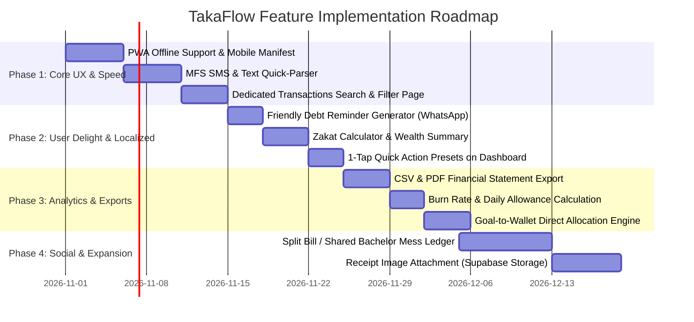

# 🗺️ TakaFlow — Product Roadmap & Feature Brainstorm

> **Document Version:** 1.0.0  
> **Status:** Active Roadmap & Planning

---

## 🧭 Executive Summary

**TakaFlow** is designed to be the premier, high-aesthetic personal finance tracker tailored for the modern Bangladeshi and global user. It bridges the gap between complex spreadsheet accounting and effortless everyday financial discipline.

---

## 📊 Current System Audit (What Exists Today)

| Module | Core Features Implemented | Current State |
| :--- | :--- | :--- |
| **Authentication** | Email & Password, 6-digit OTP verification, secure password reset, friendly error mapping | ✅ Complete & Polished |
| **Profile & Security** | User display name, avatar updates, secure email change with verification, password change with old password validation | ✅ Complete |
| **Dashboard** | Total balance in ৳ (with multi-currency conversion), individual wallet cards, active month income/expense/net summary, recent transactions list, quick add drawer | ✅ Functional |
| **Wallets & Accounts** | Multi-wallet support (Cash, Bank, Mobile Financial Services), currency support (BDT, USD, EUR, etc.), balance adjustment, transfer between wallets | ✅ Functional |
| **Transaction Engine** | Income & Expense logging, custom categories, note attachments, one-click transaction reversal (undo balance update), recurring transaction scheduler | ✅ Functional |
| **Budgeting** | Monthly budget setting, visual progress bar, traffic light alerts (safe, warning, danger) | ✅ Functional |
| **Savings Goals** | Goal target amount, deadline tracking, current saved amount, progress indicators | ✅ Functional |
| **Debts & Loans** | Lend (owed to you) vs. Borrow (you owe), partial settlement, due dates, settlement status | ✅ Functional |
| **Analytics & AI** | Monthly snapshots, income vs. expense breakdown, category charts, AI insights via Supabase Edge Function | ✅ Functional |
| **Calendar View** | Daily transaction overview, calendar heatmap, date-specific transaction drill-down | ✅ Functional |

---

## 🌟 Tier 1: "Killer" Features People Will Love (Bangladeshi & Modern Context)

These are the key differentiators that make TakaFlow uniquely valuable compared to generic trackers:

### 1. 📱 MFS SMS & Text Quick-Parser (bKash / Nagad / Rocket)
* **The Problem:** 80%+ of daily micro-expenses in Bangladesh happen via bKash, Nagad, or bank card SMS. Manually typing every ৳30 rickshaw fee or ৳350 grocery bill leads to tracker fatigue.
* **The Solution:** 
  - A **"Paste SMS / Trx Message"** field inside the Add Drawer.
  - Regex & NLP parser that automatically detects:
    - **Amount** (e.g., `Tk 450.00`)
    - **Platform / Wallet** (e.g., `bKash`, `Nagad`, `City Bank`)
    - **Transaction Type** (Cash Out = Expense, Received = Income, Send Money = Transfer/Expense)
    - **Counterparty / Reference** (e.g., `Merchant: Shawarma House`)
  - One-tap "Confirm & Log" saves 90% of user typing time.

### 2. 🤝 Friendly Debt Reminders (WhatsApp & SMS Template Generator)
* **The Problem:** Asking friends or relatives for lent money (`"Taka ta kobe dibi?"`) is socially awkward and frequently forgotten.
* **The Solution:**
  - On the **Debts** page, add a **"Send Friendly Reminder"** button next to lent records.
  - Automatically generates a polite, customizable message with a direct WhatsApp share link:
    > *"Hey [Name]! Gentle reminder regarding the ৳[Amount] for [Reason] from last week. Whenever convenient, you can bKash/Nagad me at [User Mobile Number]. Thanks!"*
  - Includes user bKash/Nagad number or payment details.

### 3. 🕌 Zakat Calculator (যাকাত ক্যালকুলেটর)
* **The Problem:** Muslims in Bangladesh calculate Zakat every Ramadan, requiring complex manual calculation across cash, bank balances, gold, business stock, and debts.
* **The Solution:**
  - One-click Zakat tab that aggregates:
    - Total liquid cash across all wallets.
    - Active lent money (recoverable receivables).
    - Deducts immediate payable debts.
    - Compares net total with live/configurable Nisab threshold (Silver/Gold standard).
    - Shows exact 2.5% Zakat amount due with breakdown export.

### 4. ⚡ 1-Tap Quick Action Presets (Smart Micro-Expenses)
* **The Problem:** Logging small repetitive expenses (Tea, Rickshaw, Lunch, Snacks) takes too many clicks.
* **The Solution:**
  - Customizable quick-log pill buttons on the Dashboard:
    - `[ ৳30 Rickshaw ]` `[ ৳50 Chai & Snacks ]` `[ ৳150 Lunch ]` `[ ৳500 Bazar ]`
  - Clicking any pill immediately logs the transaction to the default cash wallet with 0 typing required.

---

## ⚡ Tier 2: 10x User-Friendliness & Speed (UI/UX)

### 1. ⌨️ Global Command Palette (`Ctrl+K` / `Cmd+K`)
* Power users can hit `Cmd+K` anywhere:
  - `"Add 250 food"` -> parses and creates transaction instantly.
  - `"Go to Debts"`, `"Go to Goals"`, `"Switch to Dark Mode"`.
  - Search any past transaction by note, category, or amount.

### 2. 🧠 Smart Category Autocomplete & Prediction
* When the user types in the Note field:
  - If typing `"Star Kabab"` or `"burger"` -> automatically selects category **Food & Dining**.
  - If typing `"pathao"`, `"uber"`, `"cng"` -> selects **Transport**.
  - If typing `"daraz"` -> selects **Shopping**.
  - Saves the user from having to click and browse the category dropdown.

### 3. 📲 PWA (Progressive Web App) + Offline First Logging
* Full `manifest.json` and Service Worker setup.
* Allows user to "Install TakaFlow" on Android & iOS home screens.
* **Offline Logging:** Transactions created without internet are saved in IndexedDB / LocalStorage queue and auto-synced to Supabase as soon as connection is restored. No more lost logs inside basements or while on the move.

### 4. 🗂️ Full Transactions List with Advanced Filtering
* Currently, Dashboard only displays the 10 most recent transactions.
* Add a dedicated **Transactions** view with:
  - Instant text search across notes and categories.
  - Date range picker (This Week, This Month, Custom Range).
  - Wallet filter & Category multi-select filter.
  - Bulk actions (Export selected, Bulk delete, Bulk categorize).

---

## 🎯 Tier 3: Gamification, Habit Retention & Delight

### 1. 🔥 Tracking Streaks & Habit Badges
* Visual streak counter on the header (e.g., `🔥 12-Day Streak`).
* Badges for milestones:
  - *"Week One Master"* (Logged expenses 7 days in a row)
  - *"Budget Guardian"* (Stayed under monthly budget for 3 consecutive months)
  - *"Debt Crusher"* (Settled 5 debts)
* Micro-haptic animations (confetti or glowing ring) when achieving a savings goal.

### 2. 🛡️ Vault Financial Health Score (0 - 100)
* Combines:
  - Savings Rate (Income vs. Expense ratio)
  - Budget Adherence (Remaining under budget)
  - Debt-to-Income safety margin
  - Emergency Fund coverage (total balance / average monthly spend)
* Visual speedometer gauge giving users clear gamified feedback on whether their financial health is *Vulnerable*, *Balanced*, or *Elite*.

### 3. 📉 Burn Rate & Runway Projection
* Real-time calculation on Dashboard:
  - *"At your current spend of ৳620/day, your budget will exhaust on day 24."*
  - *"Safe daily allowance for remaining 10 days: ৳450/day."*
  - Prevents month-end financial crisis before it happens.

---

## 🛠️ Tier 4: Existing Feature Polish (Optimization Opportunities)

| Feature | Current Limitation | Proposed Polish |
| :--- | :--- | :--- |
| **Add Transaction Drawer** | Category dropdown requires typing or scrolling generic list | Show 4 most frequent categories as quick buttons on top of dropdown |
| **Debts Page** | Shows remaining amount but no history of partial repayments | Add expandable transaction sub-log showing partial payments with timestamps |
| **Goals Page** | User must manually calculate and track goal funds | Add a direct "Deposit from Wallet" button that debits a selected wallet and credits the goal |
| **Reports Page** | Fixed monthly view | Add Quarter-over-Quarter and Year-over-Year comparison charts |
| **Data Export** | No native export mechanism | Add one-click CSV and formatted PDF statement export |
| **Receipts** | Text notes only | Add receipt image attachment (stored in Supabase Storage bucket) |

---

## 🗓️ Phase-by-Phase Execution Roadmap

---

## 💡 Quick Reference: Priority Backlog for GSD Workflows

Use the following task IDs when kicking off development phases:

- `TKF-01`: **MFS SMS Parser** — Add regex text extractor in `AddTransactionDrawer.tsx` for bKash/Nagad SMS formats.
- `TKF-02`: **Transactions Ledger View** — Build `/transactions` route with live search, date filtering, and CSV export.
- `TKF-03`: **WhatsApp Debt Reminder** — Add WhatsApp deep-link message generator in `src/pages/DebtsPage.tsx`.
- `TKF-04`: **Quick-Log Preset Bar** — Add configurable quick-tap amount buttons on `src/pages/Dashboard.tsx`.
- `TKF-05`: **Zakat Calculator** — Create dedicated calculation modal or tab factoring net eligible assets.
- `TKF-06`: **PWA Service Worker & Manifest** — Configure Vite PWA plugin for 1-tap install on Android/iOS.
