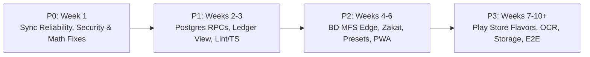

# TakaFlow — Engineering Targets & Handover Execution Plan

> **Master Action Plan for Incoming Expert Developer** · **Last Updated:** 2026-11-10  
> **Inputs:** Findings from [DIFFICULTIES.md](DIFFICULTIES.md), Architecture in [DOCUMENTATION.md](DOCUMENTATION.md), and Product Backlog in [ROADMAP.md](ROADMAP.md) / [research.md](research.md).

---

## 0. Day-0 / Day-1 Developer Onboarding Checklist

Before writing any new feature, complete these **7 stabilization hygiene steps** in order:

1. **Review the Post-`v1.0.7` Handover Commit & Create Working Branch**:
   - Inspect `git show HEAD` / `git diff 5dcd55e..HEAD` across the 27 updated files in `src/`, `android/`, and `src/test/` committed for handover visibility.
   - Add `vite.config.ts.timestamp-*.mjs` to `.gitignore` so temporary Vite config files never pollute `git status`.
   - Create a stabilization branch (e.g., `fix/p0-stabilization`) off `main` for all `P0` work.
2. **Standardize Lockfile & Package Manager**:
   - CI ([`.github/workflows/build-apk.yml`](.github/workflows/build-apk.yml)) uses `npm ci`. Remove stale [`bun.lock`](bun.lock) / [`bun.lockb`](bun.lockb) (or standardize explicitly on one lockfile) to prevent dependency skew.
3. **Fix Supabase CLI Link & Regenerate Types**:
   - Update [`supabase/config.toml`](supabase/config.toml#L1) from `"cpngaqkjvimrismpxoeg"` to `"rnzofkinmetxedimdbdv"`.
   - Add `[functions.ai-parse-voice]` (`verify_jwt = true`) to `config.toml`.
   - Sync [`supabase/schema.sql`](supabase/schema.sql) with migrations (`custom_categories`, `savings_goals` opening balance columns, `REFERENCES auth.users(id) ON DELETE CASCADE`), then run `supabase gen types typescript` into [`src/integrations/supabase/types.ts`](src/integrations/supabase/types.ts).
4. **Rotate Compromised Android Release Keystore**:
   - Generate a fresh upload/release keystore outside git, remove `android/app/release.keystore` from git history/tracking, move keystore base64 + passwords (`ANDROID_KEYSTORE_BASE64`, `KEYSTORE_PASS`, `KEY_ALIAS`, `KEY_PASS`) into GitHub Actions Encrypted Secrets, and add `*.keystore` / `*.jks` to `.gitignore`.
5. **Remove Frontend `VITE_GEMINI_API_KEY` Exposure**:
   - Remove client-side Gemini fetch from [`src/lib/aiVoiceParser.ts`](src/lib/aiVoiceParser.ts#L29-L38) (or guard strictly behind `import.meta.env.DEV`), unset `VITE_GEMINI_API_KEY` in Vercel/CI, and route production voice AI exclusively through authenticated [`supabase/functions/ai-parse-voice`](supabase/functions/ai-parse-voice/index.ts) using server-side `GEMINI_API_KEY` / `LOVABLE_API_KEY` secrets + per-user rate limiting.
6. **Verify Baseline Build & Tests**:
   - Confirm `npm test` (`101/101`), `npx tsc --noEmit`, and `npm run build` remain green before editing.
7. **Inspect Production Edge Function Secrets**:
   - In Supabase Dashboard (`rnzofkinmetxedimdbdv`), verify `LOVABLE_API_KEY`, `GEMINI_API_KEY`, `RESEND_API_KEY`, `ALLOWED_ORIGIN`, and configure **Custom SMTP (Resend/Brevo)** in Supabase Auth -> SMTP Settings to lift the 3-emails/hour limit.

---

## 1. Prioritized Milestones & Target Architecture

---

### Priority `P0` — Critical Stabilization, Data Safety & Security (Week 1)

| Target ID | Target & Problem Solved | Exact Scope & Files | Acceptance Criteria (Definition of Done) |
| :--- | :--- | :--- | :--- |
| **`P0-01`** | **Fix Outbox Never-Drop Guarantee & Dead-Letter Recovery** _(Eliminates stuck `"1 pending"` + silent deletion bugs in `DIFFICULTIES §3.2–3.4`)_ | - [`OfflineSyncBadge.tsx`](src/components/OfflineSyncBadge.tsx): NEVER call `clearOutbox()` automatically when `processOutboxSync()` returns `0`; inspect per-item `lastError`, display a retry/failed modal with "Retry All" or explicit user "Discard Item". - [`offlineSync.ts`](src/lib/offlineSync.ts): Move failed items (constraint/RLS/`attempts >= 3`) to a `FAILED` state (`status: 'failed'`, `errorMessage`) instead of `continue` dropping them; trigger `processOutboxSync` on offline delete & reverse when online; relax `withTimeout` or retry smartly after JWT refresh. - [`offlineSync.ts:282`](src/lib/offlineSync.ts#L282): Replace `qc.getQueryData(["transactions"])` with `qc.getQueriesData({ queryKey: ["transactions"] })`. | 0 silent outbox drops on network/RLS/4xx errors; clicking badge while online either syncs cleanly or surfaces actionable error; reversing tx offline restores wallet balance immediately. |
| **`P0-02`** | **Preserve Outbox Across Sign-Out Unless Explicitly Discarded** _(Fixes `DIFFICULTIES §3.3`)_ | - [`AuthContext.tsx`](src/contexts/AuthContext.tsx) & [`SignOutConfirmDialog.tsx`](src/components/SignOutConfirmDialog.tsx): Allow `signOut({ preserveOutbox?: boolean })` or prevent regular `"Sign Out"` from wiping `TAKAPERSIST_OUTBOX_V1` (namespace outbox by `userId` so user A's queue doesn't leak to user B, and auto-replay when user A logs back in). Only `"Discard offline changes & Sign Out"` clears user A's outbox. | Normal sign-out retains `userId`-scoped outbox; logging in as different user isolates queues cleanly. |
| **`P0-03`** | **Acknowledge Native SMS / Notifications Only After JS Commit** _(Fixes `DIFFICULTIES §3.1`)_ | - [`SmsReaderPlugin.java`](android/app/src/main/java/com/takaflow/financetracker/SmsReaderPlugin.java) & [`useAutoSmsSync.ts`](src/hooks/useAutoSmsSync.ts): Add deterministic ID/hash per buffered event and implement two-phase `getPendingSms()` -> JS validates wallet readiness & saves (`mutateAsync` succeeds or queues offline) -> `ackPendingSms(ids[])` deletes only acknowledged items. Also deduplicate by `trxId` / `(sender, amount, timestamp window)` to prevent double-logging if both `SmsReceiver` and `TakaFlowNotificationListener` fire for the same bKash SMS! | Launching app before `wallets` finishes loading never drops queued SMS; single SMS triggering both native listeners logs once, not twice. |
| **`P0-04`** | **Close Notification Listener Anti-Scam Bypass** _(Fixes `DIFFICULTIES §2.3`)_ | - [`TakaFlowNotificationListener.java`](android/app/src/main/java/com/takaflow/financetracker/TakaFlowNotificationListener.java): Apply `PERSONAL_PHONE_PATTERN` & `OFFICIAL_BANK_PATTERN` to all non-MFS notifications (especially SMS app packages); never default unknown senders to `"bKash"` (drop or tag `"UNVERIFIED"` so `smsParser` rejects spoofed senders); skip group chat/messaging apps (WhatsApp/Messenger/Telegram) strictly. | Unit + Android test confirms `017xxxxxxxx` SMS notification is rejected while genuine `bKash` / `NAGAD` push & official mask notifications succeed. |
| **`P0-05`** | **Fix Auth Password Reset Pagination, CORS & Domain** _(Fixes `DIFFICULTIES §2.4`)_ | - [`send-reset-email/index.ts`](supabase/functions/send-reset-email/index.ts) & [`verify-reset-token/index.ts`](supabase/functions/verify-reset-token/index.ts): Replace unpaginated `listUsers()` with Supabase Auth Admin user lookup by email (or paginated loop / RPC lookup), lock CORS using `getCorsHeaders(req)` matching `ai-insights`, configure verified Resend domain in `from` + dynamic origin allowlist, and schedule SQL cleanup of expired `password_reset_tokens`. | Works reliably beyond 50+ users; Resend delivers to arbitrary user emails. |
| **`P0-06`** | **Fix Financial Math & Drawer Bugs** _(Fixes `DIFFICULTIES §4.3–4.7`)_ | - [`useMonthRollover.ts`](src/hooks/useMonthRollover.ts): Exclude `is_reversed`, and compute `prevMonth` closing balance by backing out **all** post-`prevMonth`-end transactions (or compute chronological running balance forward). - [`GoalsPage.tsx`](src/pages/GoalsPage.tsx) & [`useStreaks.ts`](src/hooks/useStreaks.ts): Exclude `t.is_reversed` from monthly income/expense. - [`useRecurringTransactions.ts`](src/hooks/useRecurringTransactions.ts): Query `.lte("day_of_month", effectiveDayForMonth)` where `last_applied_month` != `currentMonth` (handling days 29–31 in short months + catch-up if app wasn't opened on exact due date). - [`AddTransactionDrawer.tsx:70`](src/components/AddTransactionDrawer.tsx#L70): Remove `wallets` from the form-reset `useEffect` dependency array so background refetches don't wipe active form inputs. - [`ProfilePage.tsx:341`](src/pages/ProfilePage.tsx#L341): Add `"custom_categories"` to `handleResetAccount`. | Unit tests verify rollover math mid-month, recurring catch-up on day after due date, and drawer preserving inputs across `wallets` refetch. |

---

### Priority `P1` — Database Atomicity, Core Ledger UX & Code Quality (Weeks 2–3)

| Target ID | Target & Backlog Link | Exact Scope | Acceptance Criteria (Definition of Done) |
| :--- | :--- | :--- | :--- |
| **`P1-01`** | **Atomic Postgres RPCs for Transfers, Debts & Goals** _(Fixes `DIFFICULTIES §4.1–4.2`)_ | Create SQL migration defining `SECURITY INVOKER` / `auth.uid()`-verified RPCs: 1. `transfer_wallet_funds(from_wallet_id, to_wallet_id, source_amount, converted_amount, note)` (atomic debit + credit + linked transfer log, supporting cross-currency FX rates). 2. `record_debt_payment(debt_id, wallet_id, amount, date, note)` (atomic `debt_payments` insert + `debts.remaining_amount = GREATEST(0, remaining_amount - amount)` + `settled` flag + `transactions` insert). 3. `contribute_savings_goal(goal_id, wallet_id, amount, deduct_from_wallet)` (atomic increment + completion check + optional `transactions` insert). Also fix hardcoded `৳` in [`SettingsWalletsSection.tsx:89`](src/components/settings/SettingsWalletsSection.tsx#L89) & [`Dashboard.tsx:442`](src/pages/Dashboard.tsx#L442). | Zero partial-failure wallet/debt desync; USD-to-BDT transfer credits accurate BDT equivalent; wallet cards & rows display native currency symbol (`formatMoney(amt, w.currency)`). |
| **`P1-02`** | **`TKF-02`: Dedicated Full Transactions Ledger (`/transactions`) + CSV Export** | Add `/transactions` route (new `src/pages/TransactionsPage.tsx`) linked from Dashboard `"View All"` and navigation: instant search (`note`, `category`), multi-filter (`wallet`, `type`, `category`, date range / month presets), bulk selection (categorize / reverse / delete), and RFC-4180 CSV download. | Users can search/filter beyond the Dashboard's 10-item slice and export filtered ledger to CSV cleanly. |
| **`P1-03`** | **Extend Offline Queue to Remaining Mutations** | Expand [`OutboxActionType`](src/lib/offlineSync.ts#L8-L13) to cover `UPDATE_WALLET`, `UPDATE_TRANSACTION_CATEGORY`, `CREATE_BUDGET`, and recurring toggle/debts/goals (or clearly display an offline lock badge when an action requires online atomicity like multi-wallet transfer). Never silently swallow network errors like `useUpdateWallet` currently does. | Renaming wallets or recategorizing transactions offline persists and syncs cleanly on reconnect. |
| **`P1-04`** | **Resolve 188 ESLint Errors, Tighten TypeScript & Chunk Splitting** | - Replace `any` across hooks, pages, and components using regenerated [`types.ts`](src/integrations/supabase/types.ts); fix all `no-empty` catch blocks with explicit comments/logging; resolve `command.tsx` interface warning & `SettingsAutoTrackingSection` hook dependency. - Incrementally turn on `strictNullChecks: true` and `noImplicitAny: true` in [`tsconfig.app.json`](tsconfig.app.json). - Add Vite `manualChunks` (`vendor-react`, `vendor-charts`, `vendor-supabase`, `vendor-ui`) in [`vite.config.ts`](vite.config.ts) to reduce initial `index` JS chunk from `786 kB` to `< 350 kB`. | `npm run lint` exits `0` (0 errors); CI runs `npm run lint` & `npx tsc --noEmit` alongside `npm test`; initial JS bundle `< 500 kB`. |
| **`P1-05`** | **Wire Existing Streak & Habit Badges (`useStreaks` / `StreakBadge`)** | Audit and wire [`StreakBadge.tsx`](src/components/StreakBadge.tsx) & [`useStreaks.ts`](src/hooks/useStreaks.ts) into [`Dashboard.tsx`](src/pages/Dashboard.tsx) (or [`ProfilePage.tsx`](src/pages/ProfilePage.tsx)), remove unused legacy [`SettingsAccountSection.tsx`](src/components/settings/SettingsAccountSection.tsx) / `SettingsDangerZone.tsx` if superseded. | Zero dead feature files in `src/`. |

---

### Priority `P2` — Bangladesh Market Differentiators & PWA (Weeks 4–6)

| Target ID | Feature / Task ID | Exact Scope & Notes |
| :--- | :--- | :--- |
| **`P2-01`** | **Dynamic CI Versioning & Capacitor Sync** | Fix [`.github/workflows/build-apk.yml`](.github/workflows/build-apk.yml): drive release tags dynamically from `package.json` / git tags (`v*`) instead of hardcoded `v1.0.7`; run `npx cap sync android` cleanly; sync [`UpdateCheckerModal.tsx`](src/components/UpdateCheckerModal.tsx) fallback version with [`android/app/build.gradle`](android/app/build.gradle). |
| **`P2-02`** | **`TKF-01` Completion (Manual SMS Paste UI)** | Since [`smsParser.ts`](src/lib/smsParser.ts) already powers native auto-tracking, add the collapsible `"Paste bKash/Nagad/Bank SMS"` box inside [`AddTransactionDrawer.tsx`](src/components/AddTransactionDrawer.tsx) so Web/iOS users get the same 1-tap autofill UX. |
| **`P2-03`** | **`TKF-03` WhatsApp Friendly Debt Reminder** | Add `"Send Reminder"` CTA on active `lent` cards in [`DebtsPage.tsx`](src/pages/DebtsPage.tsx) generating customizable polite Bengali/Banglish/English copy + `https://wa.me/...` deep link. |
| **`P2-04`** | **`TKF-04` 1-Tap Quick-Log Presets & Cash-Out Fee Helper** | Add configurable micro-expense pills on Dashboard (e.g., `Rickshaw ৳30`, `Chai ৳20`, `Lunch ৳150`) + BD MFS `Include Cash-Out Fee (+1.49% / +1.85%)` toggle in [`AddTransactionDrawer.tsx`](src/components/AddTransactionDrawer.tsx) for bKash/Nagad/Rocket wallets. |
| **`P2-05`** | **Balance Reconcile Tool & Burn Rate Projection** | Add 1-tap `"Reconcile Balance"` adjustment action on wallet cards (creates an explicit adjustment transaction rather than invisible balance overwrite) + Dashboard `"Safe Daily Allowance & Budget Runway"` indicator (`remainingBudget / daysLeft`). |
| **`P2-06`** | **`TKF-05` Zakat Calculator (যাকাত ক্যালকুলেটর)** | Dedicated modal/tab aggregating eligible cash + MFS + bank wallets + active recoverable `lent` debts minus short-term payable `borrowed` debts against configurable Gold/Silver Nisab thresholds, outputting exact 2.5% Zakat due. |
| **`P2-07`** | **`TKF-06` PWA Service Worker + Web App Manifest + `Cmd+K` Palette** | Add `vite-plugin-pwa` (Workbox precache + offline SPA fallback) so iOS/Desktop Safari/Chrome users can install TakaFlow and boot offline seamlessly. Wire existing `cmdk` dependency into a global `Ctrl+K` quick-command / quick-add bar. |

---

### Priority `P3` — Growth, Scale, AI Vision & Google Play Release (Weeks 7–10+)

| Target ID | Target | Scope & Rationale |
| :--- | :--- | :--- |
| **`P3-01`** | **Android Build Flavors (`directApk` vs `playStore`)** | Split `android/app/build.gradle` into: - `directApk`: retains `RECEIVE_SMS` / `READ_SMS` + `REQUEST_INSTALL_PACKAGES` (GitHub Release sideload APK). - `playStore`: strips SMS & unknown-install permissions, ships compliant `NotificationListenerService` + Google Play In-App Updates AAB + OEM battery-whitelist guide + 1x4 Android Home Screen Quick-Add Widget (`+ Expense`, `Mic`). |
| **`P3-02`** | **Supabase Storage Migration (Avatars + Receipt OCR)** | Create private/public Supabase Storage buckets (`avatars`, `receipts`) with user-folder RLS (`(storage.foldername(name))[1] = auth.uid()::text`). Migrate `ProfilePage` avatars out of `user_metadata` JWT blobs, and add Gemini Vision receipt scanning (extracting merchant, total, VAT, line items) into `AddTransactionDrawer`. |
| **`P3-03`** | **Local/Push Bill Reminders & Monthly PDF Statements** | Schedule Capacitor Local Notifications 48 hours before `recurring_transactions.day_of_month`, add printable/PDF branded monthly financial statements, and explore multi-user **"Mesher Hishab"** (bachelor mess / tour split-bill shared groups). |
| **`P3-04`** | **End-to-End Test Suite (`Playwright`) & Production Observability** | Add Playwright E2E specs under `e2e/` covering Auth, Wallet creation, Add/Reverse Transaction, Offline queue replay, and Debt settlement; integrate lightweight client error telemetry (Sentry/Logflare) so production sync failures never go unnoticed. |

---

## 2. Success Metrics (Project Exit Targets)

- **Reliability**: `0` silent data-loss scenarios in Outbox or SMS ingest; `< 1s` cold offline boot.
- **Correctness**: `100%` balance consistency across multi-step Debt, Goal, Transfer, and Rollover operations (backed by Postgres RPCs).
- **Quality Gates**: CI enforces `npm run lint` (0 errors), `npx tsc --noEmit` (with strict mode), `npm test`, and Playwright E2E smoke tests on every PR.
- **Bundle & UX**: Initial JS chunk `< 500 kB`; Play Store compliant `.aab` build ready alongside GitHub Release `.apk`.
